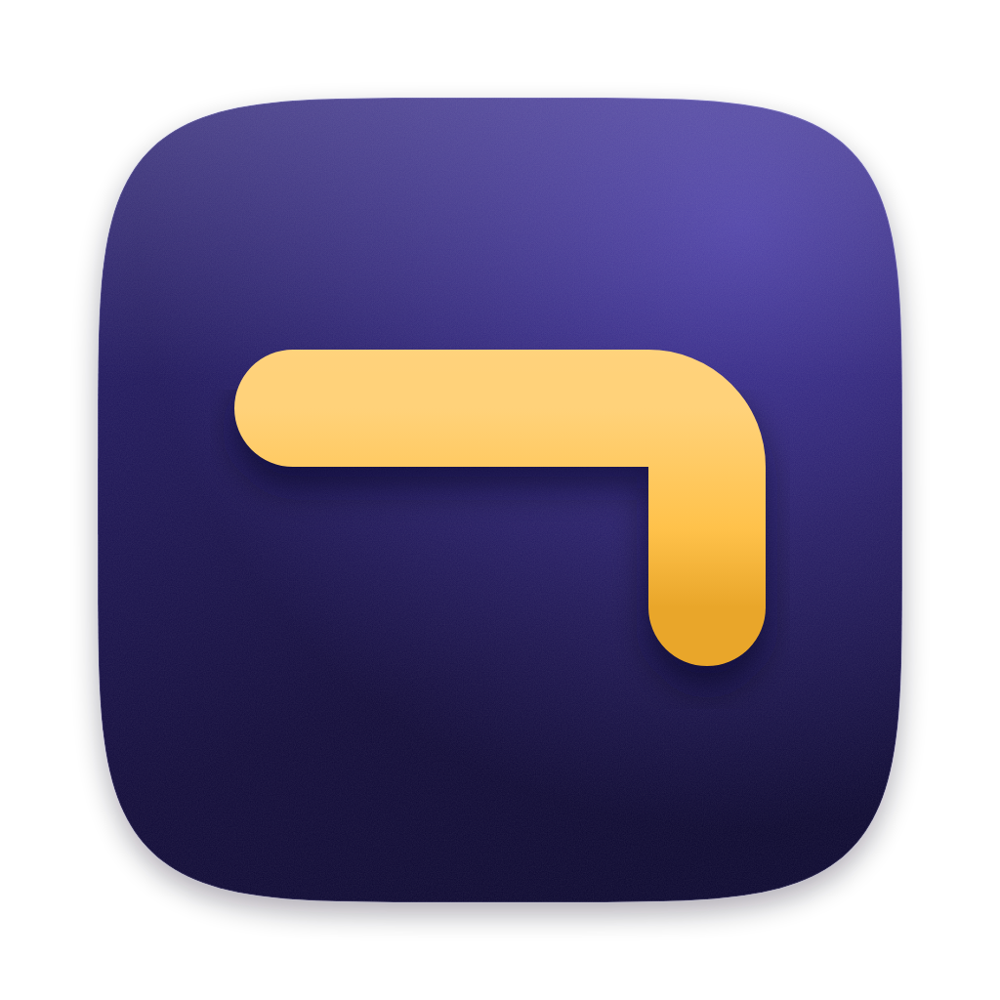
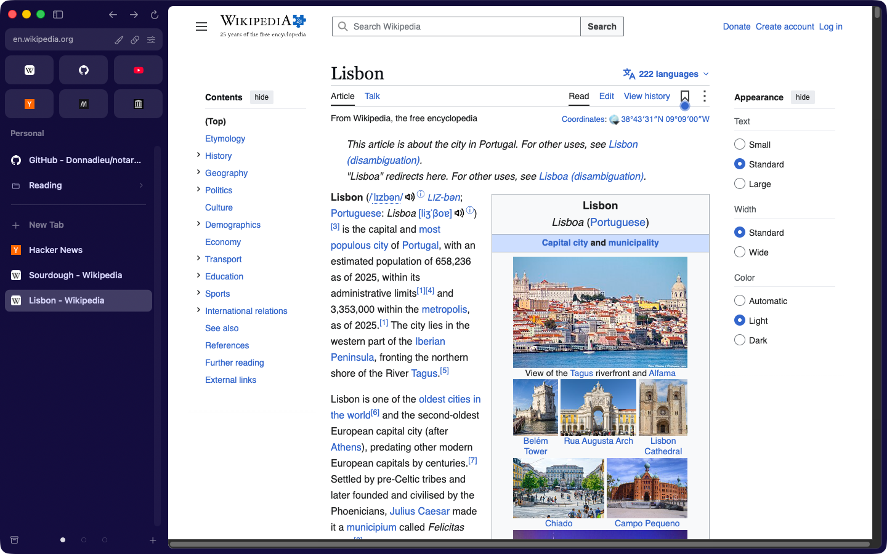
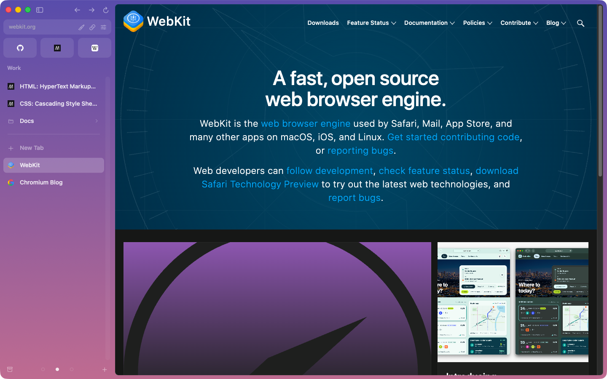
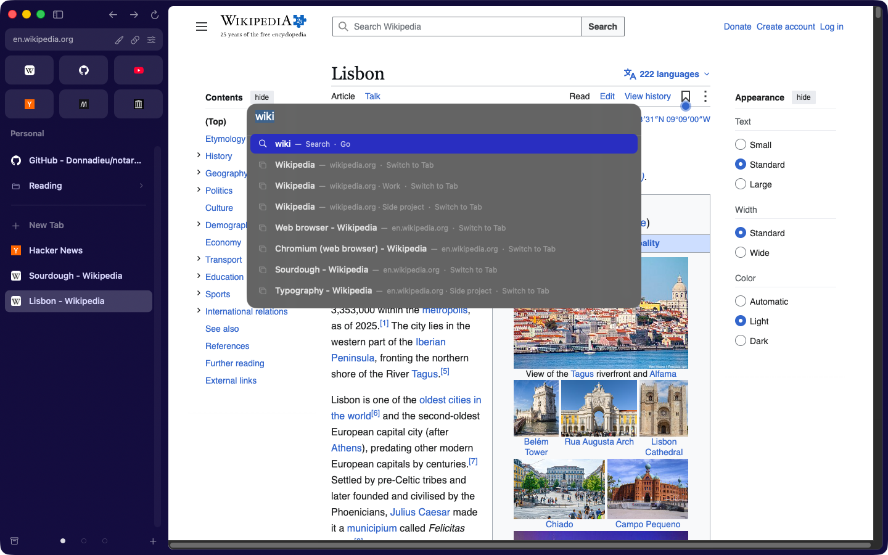
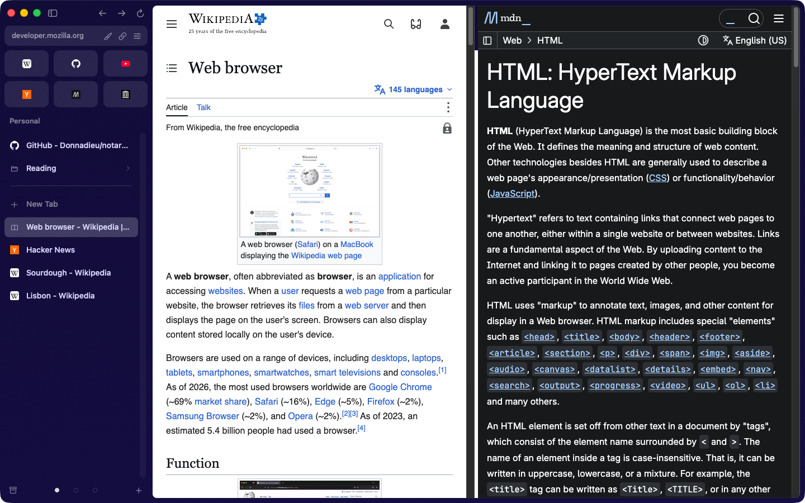

# NotArc

**Your sidebar, your Spaces, your command bar. Still here.** NotArc is a free, open-source browser for Mac that keeps
the way Arc works after Arc shuts down on December 22, 2026.

The vertical sidebar with Favorites, pinned tabs, folders and Today. Spaces with their own colours and their own logins.
Cmd+T and type. Split view, Little Window, Peek, and old tabs that tidy themselves away. NotArc does all of that today,
on Chromium, so sites work the way they do in Chrome.

VIDEO_LINE

A one-minute tour, with sound. [Download it in full quality](docs/promo/notarc-promo.mp4).

- A native Mac app (Objective-C++ on Chromium), written from scratch. MIT licensed, made by volunteers.
- On first launch it brings over your Arc Spaces, tabs, Favorites, archive and logins. It only reads Arc's files.
- Everything stays on your Mac: no account, no server, no sync service.
- It updates itself from GitHub Releases and checks every download against its published SHA-256.

**Download:** [latest release](https://github.com/Donnadieu/notarc/releases/latest).
Website: [donnadieu.github.io/notarc](https://donnadieu.github.io/notarc/).

NotArc is not Arc. It isn't affiliated with or endorsed by The Browser Company, and it contains none of Arc's code,
artwork or branding.

## Install

You need a Mac with Apple Silicon (M1 or newer) and macOS 13 or later.

1. Download `NotArc-<version>-arm64.dmg` from the [latest release](https://github.com/Donnadieu/notarc/releases/latest).
2. Open the disk image and drag **NotArc** into **Applications**.
3. The first time only, right-click NotArc in Applications and choose **Open**, then **Open** again. NotArc isn't
   notarized by Apple yet, so macOS asks you to confirm. If macOS still refuses, go to System Settings > Privacy &
   Security and click **Open Anyway**.

On first launch NotArc offers to bring everything over from Arc. To bring your logins too, macOS asks once for access
to the "Arc Safe Storage" Keychain item; click **Allow**. That key decrypts Arc's saved cookies on your own Mac. Nothing
leaves your computer, and Arc's files are never changed.

After that NotArc checks for a new version once a day and offers **Install and Relaunch** (or use NotArc > Check for
Updates...). On 0.4.0 or earlier, download the newer release once and replace the app in Applications. Your data stays
in `~/Library/Application Support/NotArc`.

## What it does

**Sidebar and tabs**
- Favorites as icon tiles, Pinned tabs and folders (nested, drag and drop), and Today below
- Pin with Cmd+D; pinned tabs remember their address (Reset to Pinned URL, Replace Pinned URL with Current, Close and
  Keep Pinned), and pinning gives a tab a short, tidy name, with Undo
- Multi-select (Cmd/Shift-click) to copy links (plain or Markdown), make a folder, pin, move to another Space or archive
- Hover cards with a picture of the page, Ctrl+Tab switcher with thumbnails, unread badges, Undo Close Tab (Cmd+Z), Copy URL as Markdown, Copy Clean Link
- Arc's keyboard shortcuts: Cmd+1-9 for tabs, Cmd+Opt+Up/Down, Ctrl+Tab for the most recent tab, Cmd+S to hide the
  sidebar, and your own shortcuts for any menu command

**Spaces**

- Each Space has its own browser profile, so work and personal logins stay apart
- A colour or a two-colour gradient with grain per Space, an emoji icon, light or dark
- Ctrl+1-9, Cmd+Opt+Left/Right or a two-finger swipe over the sidebar to switch
- Each Space reopens on the tab you were last on

**Command bar**

- Cmd+T and Cmd+L: go to an address or search, with suggestions from open and pinned tabs in every Space, Spaces,
  history and menu commands, plus your top sites when the field is empty
- It learns what you pick. Search with Google, DuckDuckGo, Bing, Ecosia or Kagi

**Split view, Little Window and Peek**

- Split view with up to 4 panes in any direction; drag a tab onto the page to split; a split is one sidebar item and
  comes back after a restart
- Little Window for links opened from other apps (Cmd+Option+N from anywhere), with Open in NotArc and Move to Space
- Peek: links that leave a pinned site open in an overlay; Open as Tab, or Undo after closing one
- Air Traffic Control: rules for which Space opens which links (your Arc rules come over)
- Toolbar mode (Cmd+Shift+S) with back, forward, reload and the full address; Focus Mode and full screen

**Library**
- Auto-archive: Today tabs you haven't used for 12 hours (6 hours to 30 days, or never) move to a searchable Archive
- History (Cmd+Y), Downloads (Cmd+Shift+J), Clear Browsing Data (Cmd+Shift+Delete)

**Browsing**
- Media controls in the sidebar, automatic picture-in-picture, mute and camera buttons during calls
- NotArc asks before sites use your camera, microphone, location or notifications; Site Settings (Cmd+Shift+I)
- Crashed pages show a Reload button; frozen pages offer Wait or Exit Page; after a crash, your open tabs come back
- Built-in PDF viewer, find in page, zoom, print, Translate, DevTools

**Also built**
- Passwords: saved when you sign in and filled in for you, addresses and cards too, shown behind Touch ID; imported
  from Arc, Chrome-family browsers or a CSV file
- Max, on your Mac with Apple's built-in model: Ask on Page (Cmd+Shift+A), Summarize Page, link previews, Tidy Today
  Tabs into folders, plus "Ask ChatGPT" from the command bar with your own sign-in
- Chrome extensions from the Chrome Web Store (with Chrome-style pages turned on), ad and tracker blocking with filter
  lists
- Capture (area, visible page, full page, portrait), Boosts (per-site colours, fonts, zaps, CSS and JavaScript),
  Notes (with Markdown export and split view), Easels (drawing and live clips), Live Folders (RSS, GitHub, YouTube)
- Next meeting from the Mac's Calendar with a Join button; Gmail and calendar previews on Favorites
- Multiple windows, Incognito windows, AppleScript
- Import bookmarks and history from Chrome, Brave, Edge, Vivaldi, Chromium, Firefox and Safari

The [parity checklist](docs/feature-parity.md) tracks every Arc feature, and [CHANGELOG.md](CHANGELOG.md) lists what each
release added.

## Built on Chromium, upgraded with Chromium

NotArc is a native macOS app written in Objective-C++. It embeds Chromium through the
[Chromium Embedded Framework](https://bitbucket.org/chromiumembedded/cef) (CEF), so websites behave exactly as they do
in Chrome. Upgrading to a newer Chromium means downloading a newer CEF build and rebuilding.

Current pin: CEF 156.0.7 (Chromium 156.0.8078.17), Apple Silicon.

## Build from source

Requirements: an Apple Silicon Mac, Apple's Command Line Tools (Xcode isn't needed), `cmake` and `ninja`
(`brew install cmake ninja`).

1. Download the CEF "Standard Distribution" for macOS ARM64 from https://cef-builds.spotifycdn.com/index.html,
   unpack it under `third_party/std/`, and link it: `ln -sfn std/<cef_binary_folder> third_party/cef`
2. `mkdir -p build && cd build && cmake -G Ninja -DCMAKE_BUILD_TYPE=Release .. && ninja`
3. Open `build/Release/NotArc.app`
4. Optional: `scripts/package.sh` makes the release disk image in `dist/`

Developer flags: `--selftest` runs the automated self-test (separate test data; it never touches your own profiles,
settings or Keychain), `--dump-arc` prints what would be imported from Arc, and `--dump-store` prints NotArc's saved
sidebar.

## Project layout

- `app/`: the browser (window, sidebar, command bar, archive, downloads, history, updater, Arc import)
- `scripts/`: packaging (`package.sh`) and end-to-end tests for updates and crash recovery
- `site/`: the website, published to GitHub Pages
- `assets/brand/`: the app icon and the ¬ mark
- `docs/feature-parity.md`: checklist of every Arc feature and its status in NotArc
- `docs/decisions.md`: why some Arc features are out of scope
- `docs/arc-data-format.md`: how Arc stores your sidebar and archive on disk, so they can be imported
- `CHANGELOG.md`: what each release added
- `CONTRIBUTING.md`: how to build, test and contribute

## Help wanted

NotArc is built by volunteers, and there's always more to polish: the partly done items on the checklist, bugs, and
whatever you miss from Arc. If you know C++, Objective-C++ or macOS development, or
just use Arc every day and can test, we'd love your help.

- See what's missing in the [parity checklist](docs/feature-parity.md).
- Pick an issue labelled [good first issue](https://github.com/Donnadieu/notarc/labels/good%20first%20issue) or
  [parity](https://github.com/Donnadieu/notarc/labels/parity).
- Read [CONTRIBUTING.md](CONTRIBUTING.md) for how to build, test and send a pull request.
- Questions and ideas go in [Discussions](https://github.com/Donnadieu/notarc/discussions).

Please don't contribute anything copied from Arc (code, icons, images or text). NotArc has to stay an independent
implementation.

## License

MIT. See [LICENSE](LICENSE). "Arc" is a trademark of The Browser Company of New York; it's mentioned here only to
describe compatibility.
